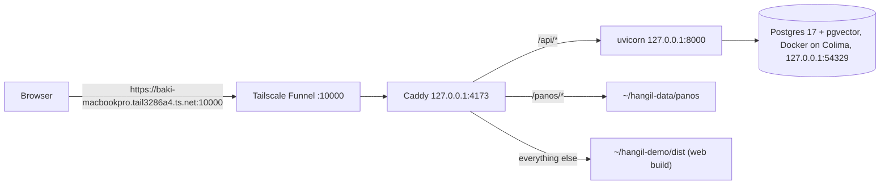

# 한길 (Hangil) infra

How the Hangil demo runs on **macserver** (a team Mac on the tailnet) and how it gets deployed. No secrets live here; this repo is public.



## Repositories

| Repo | Visibility | Holds |
| --- | --- | --- |
| [oneload-backend](https://github.com/team-onetruck/oneload-backend) | private | API code, tests, CI, the deploy workflow |
| [oneload-data](https://github.com/team-onetruck/oneload-data) | public | maps and street-view photos |
| oneload-infra (this) | public | `macserver/deploy.sh`, Caddyfile, launchd agents |
| [oneload-app](https://github.com/team-onetruck/oneload-app) | private | web client |

## Deploying

The **only** deploy path is the `deploy` job in oneload-backend's `ci.yml`. It runs on the self-hosted runner `macserver-hangil` (label `hangil`), checks out backend, infra and data, and runs:

```sh
macserver/deploy.sh <backend-dir> <data-dir>
```

The script syncs code and data, loads the maps with the new code before switching anything (a broken map stops the deploy and the running API keeps the old data), migrates the database, and reloads two launchd agents:

| Agent | Runs | Log |
| --- | --- | --- |
| `com.onetruck.hangil-api` | uvicorn, `MAP_DIR=~/hangil-data/maps` | `~/Library/Logs/hangil-api.log` |
| `com.onetruck.hangil-caddy` | Caddy with `~/hangil-demo/Caddyfile` | `~/Library/Logs/hangil-caddy.log` |

Both start at login and restart if they crash. Postgres runs under Docker with `restart: unless-stopped`; Colima itself starts as a Homebrew service.

After changing this repo or oneload-data, redeploy with:

```sh
gh workflow run ci.yml -R team-onetruck/oneload-backend
```

**Never** attach a self-hosted runner to this repo or oneload-data: they are public, so a pull request from a fork could run code on macserver.

## Settings and secrets

GitHub repository secrets in oneload-backend. The deploy step maps each one to an `APP_*` variable and `deploy.sh` writes them to `~/hangil-api.env` (mode 600, replaced on every deploy). Add a setting with `gh secret set NAME -R team-onetruck/oneload-backend` plus one `APP_NAME: ${{ secrets.NAME }}` line in that workflow.

## Web client

The web build is copied by hand for now:

```sh
pnpm build && rsync -a --delete dist/ macserver:~/hangil-demo/dist/
```

## Server setup notes

- Funnel: `tailscale funnel --bg --https=10000 http://127.0.0.1:4173`. Ports 443 and 8443 on this machine belong to another project.
- Runner: registered to oneload-backend only, installed with `./svc.sh install` in `~/actions-runner-hangil`.
- Tools from Homebrew: `uv`, `caddy`, `colima`, `docker`.
