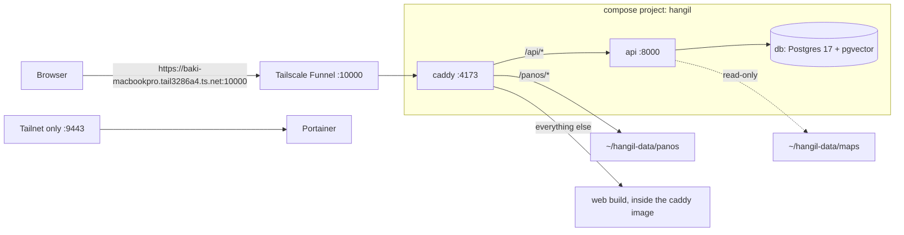

# 한길 (Hangil) infra

How the Hangil demo runs on **macserver** (a team Mac on the tailnet) and how it gets deployed. No secrets live here; this repo is public.

Everything runs in Docker (Colima) as the compose project **`hangil`**, so the whole stack shows up in Portainer.



## Repositories

| Repo | Visibility | Holds |
| --- | --- | --- |
| [oneload-backend](https://github.com/team-onetruck/oneload-backend) | public | API code + `Dockerfile`, tests, CI, the deploy workflow |
| [oneload-data](https://github.com/team-onetruck/oneload-data) | public | maps and street-view photos |
| oneload-infra (this) | public | `macserver/compose.yaml`, Caddyfile, `web.Dockerfile`, `deploy.sh`, Portainer |
| [oneload-app](https://github.com/team-onetruck/oneload-app) | public | web client, built into the `hangil-web` image |
| [oneload_agent](https://github.com/team-onetruck/oneload_agent) | public | conversation and vision agent, a pinned dependency of the API |

## Deploying

The **only** deploy path is the `deploy` job in oneload-backend's `ci.yml`. It runs on the self-hosted runner `macserver-hangil` (label `hangil`), checks out backend, infra, data and app, and runs:

```sh
macserver/deploy.sh <backend-dir> <data-dir> <app-dir>
```

In order, the script:

1. writes `~/hangil-api.env` from repository secrets;
2. copies `compose.yaml`, `Caddyfile` and `web.Dockerfile` to `~/hangil`;
3. builds the `hangil-api` image from the backend checkout and the `hangil-web` image from the app checkout;
4. loads the new maps with the new image and stops if they are broken (the running API keeps its data);
5. syncs `maps/` and `panos/` to `~/hangil-data`, migrates the database, and runs `docker compose up -d --wait`;
6. reloads Caddy, makes sure Portainer is up, and prunes old images.

All containers use `restart: unless-stopped`, and Colima starts as a Homebrew service, so the stack comes back after a reboot.

What starts a deploy:

| Change in | Starts the deploy by |
| --- | --- |
| oneload-backend | its own push to `main` |
| oneload-app | its CI's `deploy` job, after `main` passes |
| oneload_agent | its CI's `deploy` job, after `main` passes: oneload-backend's `agent-bump.yml` pins the new commit, then starts CI / Deploy |
| oneload-data, this repo, a secret | hand: `gh workflow run ci.yml -R team-onetruck/oneload-backend` |

The app and agent hand-offs use the secret `HANGIL_DEPLOY_TOKEN` in those repos: a fine-grained token for oneload-backend only, with Actions read and write.

All team repos are public now. Only oneload-backend has a runner, and its fork PR workflows wait for a maintainer's approval; **never** approve a fork PR run that touches `.github/`, and never attach a runner to another repo.

## Looking at it

- **Portainer**: `https://baki-macbookpro.tail3286a4.ts.net:9443` (tailnet only). Containers → filter by stack `hangil` for status, logs, CPU and memory. Docker on this machine also runs the seoul-bike project.
- Shell: `cd ~/hangil && docker compose ps` / `docker compose logs -f api`.

Portainer asks for an admin account on the first visit and locks setup after 5 minutes; if that happens, `docker restart portainer-portainer-1` and open it again.

## Settings and secrets

GitHub repository secrets in oneload-backend. The deploy step maps each one to an `APP_*` variable and `deploy.sh` writes them to `~/hangil-api.env` (mode 600, replaced on every deploy), which the `api` service loads. Add a setting with `gh secret set NAME -R team-onetruck/oneload-backend` plus one `APP_NAME: ${{ secrets.NAME }}` line in that workflow.

## Web client

Built from oneload-app's `main` on every deploy (`web.Dockerfile`: `pnpm install --frozen-lockfile`, `pnpm build`, result copied into a Caddy image). The server needs no Node, and the same image serves the build and proxies the API.

## Server setup notes

- Public: `tailscale funnel --bg --https=10000 http://127.0.0.1:4173`. Ports 443 and 8443 on this machine belong to another project.
- Portainer, tailnet only: `tailscale serve --bg --https=9443 http://127.0.0.1:9000`.
- Runner: registered to oneload-backend only, installed with `./svc.sh install` in `~/actions-runner-hangil`. Every team repo requires maintainer approval before a fork PR's workflows run (Settings → Actions → "all outside contributors").
- Tools from Homebrew: `colima`, `docker`, `docker-compose`.
