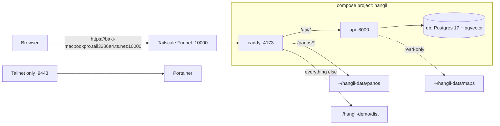

# 한길 (Hangil) infra

How the Hangil demo runs on **macserver** (a team Mac on the tailnet) and how it gets deployed. No secrets live here; this repo is public.

Everything runs in Docker (Colima) as the compose project **`hangil`**, so the whole stack shows up in Portainer.



## Repositories

| Repo | Visibility | Holds |
| --- | --- | --- |
| [oneload-backend](https://github.com/team-onetruck/oneload-backend) | private | API code + `Dockerfile`, tests, CI, the deploy workflow |
| [oneload-data](https://github.com/team-onetruck/oneload-data) | public | maps and street-view photos |
| oneload-infra (this) | public | `macserver/compose.yaml`, Caddyfile, `deploy.sh`, Portainer |
| [oneload-app](https://github.com/team-onetruck/oneload-app) | private | web client |

## Deploying

The **only** deploy path is the `deploy` job in oneload-backend's `ci.yml`. It runs on the self-hosted runner `macserver-hangil` (label `hangil`), checks out backend, infra and data, and runs:

```sh
macserver/deploy.sh <backend-dir> <data-dir>
```

In order, the script:

1. writes `~/hangil-api.env` from repository secrets;
2. copies `compose.yaml` and `Caddyfile` to `~/hangil`;
3. builds the `hangil-api` image from the backend checkout;
4. loads the new maps with the new image and stops if they are broken (the running API keeps its data);
5. syncs `maps/` and `panos/` to `~/hangil-data`, migrates the database, and runs `docker compose up -d --wait`;
6. reloads Caddy, makes sure Portainer is up, and prunes old API images.

All containers use `restart: unless-stopped`, and Colima starts as a Homebrew service, so the stack comes back after a reboot.

After changing this repo or oneload-data, redeploy with:

```sh
gh workflow run ci.yml -R team-onetruck/oneload-backend
```

**Never** attach a self-hosted runner to this repo or oneload-data: they are public, so a pull request from a fork could run code on macserver.

## Looking at it

- **Portainer**: `https://baki-macbookpro.tail3286a4.ts.net:9443` (tailnet only). Containers → filter by stack `hangil` for status, logs, CPU and memory. Docker on this machine also runs the seoul-bike project.
- Shell: `cd ~/hangil && docker compose ps` / `docker compose logs -f api`.

Portainer asks for an admin account on the first visit and locks setup after 5 minutes; if that happens, `docker restart portainer-portainer-1` and open it again.

## Settings and secrets

GitHub repository secrets in oneload-backend. The deploy step maps each one to an `APP_*` variable and `deploy.sh` writes them to `~/hangil-api.env` (mode 600, replaced on every deploy), which the `api` service loads. Add a setting with `gh secret set NAME -R team-onetruck/oneload-backend` plus one `APP_NAME: ${{ secrets.NAME }}` line in that workflow.

## Web client

The web build is copied by hand for now and served from a bind mount, so no restart is needed:

```sh
pnpm build && rsync -a --delete dist/ macserver:~/hangil-demo/dist/
```

## Server setup notes

- Public: `tailscale funnel --bg --https=10000 http://127.0.0.1:4173`. Ports 443 and 8443 on this machine belong to another project.
- Portainer, tailnet only: `tailscale serve --bg --https=9443 http://127.0.0.1:9000`.
- Runner: registered to oneload-backend only, installed with `./svc.sh install` in `~/actions-runner-hangil`.
- Tools from Homebrew: `colima`, `docker`, `docker-compose`.
